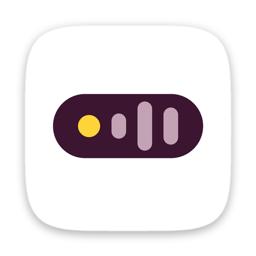

  

<h1 align="center">Monkey Mode</h1>

  <b>Talk instead of type, in every app on your Mac.</b> 
  Hold a key, speak, let go. Clean text lands wherever your cursor is.

  <a href="https://github.com/milanrunscode/MonkeyMode/releases/latest/download/MonkeyMode.dmg"><b>⬇︎ Download Monkey Mode (DMG)</b></a>
  &nbsp;·&nbsp; <a href="https://monkeymode.app">monkeymode.app</a>
  &nbsp;·&nbsp; macOS 14 or later

---

## What is Monkey Mode?

Monkey Mode is a voice app for the Mac. It turns what you say into clean text in any app, takes notes in your meetings and does things for you when you ask.

This repository is where you download the app and read how it works. **The source code is not public.**

## What it does

- **Dictation.** Hold `fn`, speak, let go. Double-tap for hands-free. Clean-up removes filler words and fixes punctuation.
- **Private or cloud, your choice.** Run speech on your Mac with a downloaded model, or use the cloud with your own key.
- **Meeting notes.** A live transcript, then a summary with action items.
- **Hey Monkey.** Start with your word and Monkey sets timers, opens apps and answers instead of typing it.
- **Tasks.** Say what needs doing and get reminded.
- **Transforms.** Select text in any app and rewrite it with a shortcut.
- **Agents.** Helpers that work in the background and stop to ask when something needs your OK.
- **The Monkey Bar.** A small bar at the edge of your screen that shows when Monkey Mode is listening.

## Install

1. [Download the DMG](https://github.com/milanrunscode/MonkeyMode/releases/latest/download/MonkeyMode.dmg).
2. Open it and drag Monkey Mode to Applications.
3. Open Monkey Mode. The setup walks you through your key, your speech model and the permissions, and explains each one before macOS asks.

Monkey Mode is signed with a Developer ID and notarized by Apple.

## Permissions

Monkey Mode asks only when a feature needs it, and says why first.

| Permission | What for | When it asks |
|---|---|---|
| Microphone | Hearing you while you dictate | During setup |
| Accessibility | Typing at your cursor, your key in every app | During setup |
| Input Monitoring | Your hotkey in other apps, only without Accessibility | During setup, if needed |
| Screen Recording | A look at your screen, a meeting's video | The first time you use it |
| System audio | The other side of a call in meeting notes | The first meeting |
| Automation, Contacts, Reminders, Calendar | Actions you ask for | The first time you use them |

## Pro

Dictation, clean-up, the Monkey Bar, the Dictionary and the Scratchpad are free. Pro adds Transforms, Hey Monkey actions, Meeting notes, Tasks, Insights & Focus and My Voice.

The first 10,000 people get Pro free for life. Enter your email in the app, then the 6-digit code we send you. After that, Pro is $29 once.

## Help and feedback

- Help inside the app: Hub › Help
- Questions and bugs: [open an issue](https://github.com/milanrunscode/MonkeyMode/issues)

---

© Holler Ventures GmbH. All rights reserved. Monkey Mode is not made by or affiliated with Apple.
